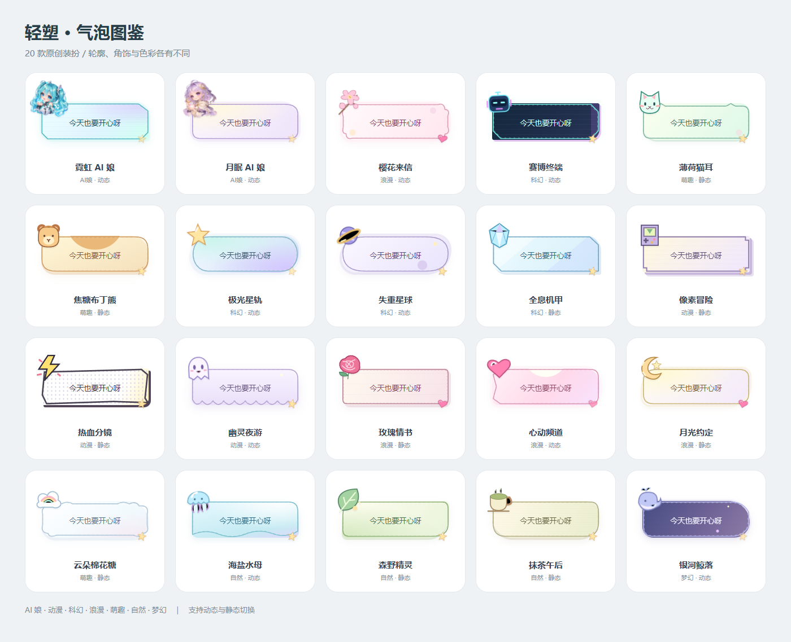

# r182 / 2.2.21（66）：20款原创私聊气泡

2026-10-23，Asia/Taipei。状态：本地验收及发布验证中；最终部署证据将在发布后归档。

将原来的五个纯色圆点扩展成完整装扮面板：20款原创主题，分类筛选、真实消息预览、确认应用与动效开关。保留五款经典纯色。装扮仍只改变自己看到的自己消息，对方气泡保持原样；贴纸不额外套框，撤回消息不带装饰。

|类型|主题|
|---|---|
|AI娘|霓虹 AI 娘、月眠 AI 娘|
|动漫|像素冒险、热血分镜、幽灵夜游|
|科幻|赛博终端、极光星轨、失重星球、全息机甲|
|浪漫|樱花来信、玫瑰情书、心动频道、月光约定|
|萌趣|薄荷猫耳、焦糖布丁熊、云朵棉花糖|
|自然|海盐水母、森野精灵、抹茶午后|
|梦幻|银河鲸落|

20种独立SVG边框路径，配合切角、猫耳、像素阶梯、幽灵裙摆、波浪和信笺等外形、多彩底纹及原创角饰。两款原创AI娘插画由内置imagegen生成，其他角饰以SVG编写，未提取参考App的素材。来源及提示词见[素材说明](release-evidence-r182/art-provenance.md)。

10款支持角饰轻浮/星光呼吸；动效开关保存在当前设备，遵循系统“减少动态效果”，离屏及应用页面隐藏时暂停。主题本身存入现有服务器个人设置，无新增数据库迁移。消息读取回执同时返回本人主题，修复刷新后直接进入私聊需要先打开“我的”才恢复主题的问题；响应受原会话身份检查及本地主题变化保护。

两张插画合计3,877,520字节，只在用到时加载，不加入Service Worker安装预缓存。JS/CSS独立模块，有单独体积预算；原有首屏预算未放宽。原图透明PNG保留在assets中，不依赖外部图片站。

验收覆盖：20款实际保存与短/长消息换肤、刷新恢复、分类与取消预览、保存失败不切换、对方不变、320/393/1200像素面板无横向溢出、卡片高度和底部应用按钮、系统及手动关闭动效、经典主题切回、服务端白名单拒绝非法ID、资源实际字节。启用AI娘主题后执行完整私聊表情/语音/图片/视频及账号切换回归。生产发布后另做资源和签名包核验。

本轮没有连接ADB实体手机，真实Chrome移动尺寸测试与APK构建不代替实体安装和不同机型性能验证。

