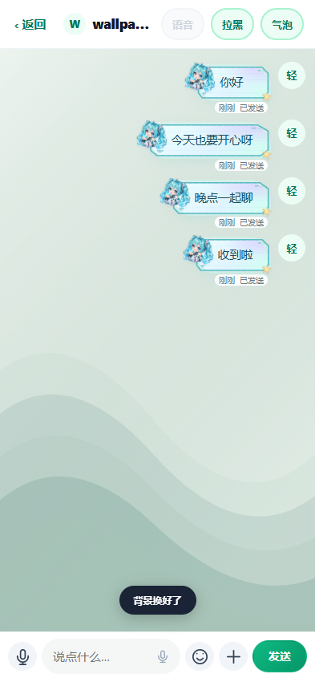
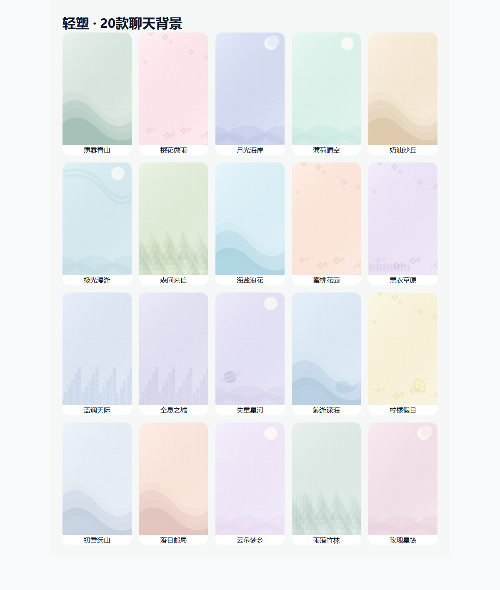

# r183 / 2.2.22（67）：紧凑气泡与20款聊天背景

状态：网页与正式签名APK已发布，完整CI与真实HTTPS网页验收通过。2026-10-23，Asia/Taipei。

修复上一版短消息被时间、投递状态、过大留白撑成竖卡片的问题。20款装扮继续保留：正文按内容撑开，时间与状态在框外同一行，装饰角色从62px缩至40px，其他角饰26px，消息间距收紧。细化角落刻线、铆钉和主题小配饰。长消息继续使用自适应轮廓，避免拉伸曲线穿过正文。真实393px浏览器中，全部20款的“你好”气泡本体不超过49px高，实际约40px；没有隐藏已读/发送失败与重试状态。

新增聊天背景面板：进入私聊右上角“气泡”→“聊天背景”，可预览20款原创矢量背景、上传图片、恢复默认和删除本机背景。涵盖青山、樱花、月岸、薄荷、沙丘、极光、森林、海浪、蜜桃、薰衣草、城市、机甲、星球、鲸鱼、柠檬、雪山、落日、云朵、竹林及玫瑰。

背景使用当前浏览器或App的本机IndexedDB，按本人账号ID与聊天对象ID隔离；与服务器气泡主题的跨设备保存机制不同，背景不会自动同步到其他设备。上传图片不发送至服务器或对方，也不进入Service Worker缓存。仅接收JPG/PNG/WebP，限制12MB、3200万像素，本机解码并缩至最长1600px后重新编码JPEG保存。恢复默认覆盖旧图片记录，删除本机背景清除当前聊天的记录。原图不写入相册或项目目录。清除应用/浏览器数据会移除本机背景，正常升级保持原有应用数据时继续保留。

真实浏览器覆盖：全部20款气泡短消息高度、框外元数据；长消息、API持久化与刷新；20款背景逐个切换；真实图片解码/保存/刷新恢复；不同聊天与账号隔离；非法图片拒绝；删除后恢复默认；320/393/1200尺寸面板及应用按钮可见。另做原有私聊表情、语音、图片、视频、重试、账号切换等回归。测试记录和实装截图见[证据目录](release-evidence-r183/)。

上传图片与内置背景都仅装扮聊天消息区域，输入栏和顶部操作不跟随背景滚动；双方仍看到各自选择的背景。没有改变互关语音通话、图片/视频权限。

本地结果：装扮/背景真实Chrome9组检查、完整私聊Chrome34组检查、旧后端623/623、旧前端355/355、前端体积预算22/22，以及图片资源、账号切换、离线缓存、投递状态/通话和转文字竞态回归通过；页面脚本错误0。正式签名与13项APK/H5资源字节一致性通过。

本轮无实体手机安装/机型性能验证。Chrome移动尺寸、WebView资源打包和正式签名检查分别记录，不把浏览器测试当作实体手机验收。

发布结果：[CI 39960300921](https://github.com/clowndest-svg/JianZhiSuXingRuanJian/actions/runs/39960300921) 的android / integration / deploy全部成功。生产release `r39960300921`，候选源码 `07b5ab7677421f9c5f935c8f7d3f52b534b71555`。主服务和后台active、健康ok、后台配对true、schema12，API强更门仍为0；后台仓没有变更。

线上实际APK 9,387,960字节，SHA-256 `2506d7335afe90628289c69455d665d0dc9a4439ec37de4fa784dd1cb4a01447`。v2/v3正式签名通过，证书指纹与既有正式版一致。13项APK资源与源码相同，12项线上静态资源与源码相同，首页带版本号的气泡及背景模块入口通过。仓库发布物已同步为线上真实包。

真实HTTPS网页使用两个临时账号验证：实际短消息高度不超过49px；20款背景入口及森林背景应用；本地图片解码、保存，关闭并重新启动独立测试浏览器后恢复；删除后回到默认。期间没有图片上传接口请求。初次探针等待整页load超时，尚未执行功能检查，账号在finally清理；随后使用DOMContentLoaded及实际模块就绪判据重跑，上述功能断言不变，4组检查全部通过。两批共4个临时账号及消息清理完毕，真实用户仍为2、外键异常0，没有改动真实用户设置。

发布前备份 `/opt/qingsu/backups/release-20261023-214557` 保留。数据库已恢复到隔离内存SQLite，完整性ok、外键异常0、用户2；备份内66版APK哈希与备份清单一致。未覆盖生产文件，不等同于整台服务器重建演练。部署QA配置已清理。

本机测试夹具输出继续保留在_audit_sandbox；上轮递归清理被自动审批以“blocked by policy”拦截，本轮未重复尝试。正式素材、验收证据、签名密钥、生产数据及回滚备份保留。

最后归档提交仅同步实际线上APK/manifest及发布证据，使用skip ci；业务源码对应上述已经通过完整流水线的候选。
